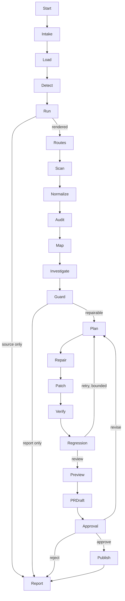

# AccessPilot

AccessPilot is an autonomous accessibility repair agent for web applications. It renders routes with Playwright, scans them with axe-core, maps findings to an isolated source copy, plans and applies conservative repairs, re-scans the result, and pauses at a resumable human gate before any push or pull request.

The application is implemented as a typed Google ADK 2 graph with conditional routes, transient retries, a bounded repair loop, six specialist LLM agents, deterministic safety guards, a FastAPI backend, and an accessible React review UI.

## What works

- Website URLs, local folders, and public GitHub repository URLs.
- React, Next.js, Angular, Vue, Svelte, plain HTML, Django, Flask, and generic
  Node/server-rendered framework hints.
- Deterministic Playwright + axe-core scans with screenshots, cumulative WCAG
  A/AA/AAA filtering across rendered and focused source checks, and bounded
  same-origin route discovery for trusted local/demo applications.
- Stable issue normalization with severity, WCAG references, route, selector, DOM evidence, explanation, strategy, and confidence.
- Source mapping, grouped repair planning, conservative
  HTML/CSS/JSX/TSX/Vue/Svelte repairs, diff hashing, repeat scans, project
  checks, and regression comparison.
- Gemini or OpenAI-compatible models through an enterprise LLMproxy abstraction.
- Before/after review, PR draft generation, and approval bound to the exact diff, verification result, and Git HEAD.
- A bundled vulnerable app whose exact baseline varies with axe and focused
  source checks. The current end-to-end AA integration reaches zero remaining
  findings; the checked-in scan-only local eval reports 7 original findings.

## Quick start

Requirements: Python 3.11–3.13, [uv](https://docs.astral.sh/uv/), Node.js 20+, npm, and `agents-cli` 1.0+.

```bash
uv tool install google-agents-cli
agents-cli install

cd scanner
npm install
npx playwright install chromium
cd ..

cd frontend
npm install
npm run build
cd ..

cp .env.example .env
```

Credential entries in `.env.example` are intentionally blank. UI/API runs use
the typed deterministic specialist fallback when the selected provider has no
real credentials. `ACCESSPILOT_DETERMINISTIC_SPECIALISTS=true` also forces that
fallback for the scaffold/native ADK root graph. Never place secrets in tracked
files.

Start the application:

```bash
ACCESSPILOT_DETERMINISTIC_SPECIALISTS=true \
  uv run uvicorn app.fast_api_app:app --host 127.0.0.1 --port 8000
```

Open [http://127.0.0.1:8000](http://127.0.0.1:8000), choose **Use bundled vulnerable app**,
and start a run. AccessPilot scans, repairs, verifies,
prepares previews and PR text, then waits for approve, reject, or revise. The
remote-publication checkbox stays disabled unless the API server was started
with `ACCESSPILOT_ENABLE_REMOTE_MUTATIONS=true`; even then, a run must opt in
and a reviewer must approve the exact verified state before any network
mutation.

Container build (includes Node 20, Chromium, scanner dependencies, UI, and the
sample app):

```bash
docker build -t accesspilot .
docker run --rm -p 8080:8080 \
  -e ACCESSPILOT_ALLOW_REMOTE_CLIENTS=true \
  accesspilot
```

The explicit remote-client switch is needed for traffic crossing Docker's
bridge. Keep the port local or place the service behind an authenticated proxy;
local execution, dependency installation, and remote mutations remain disabled.

`uv build` runs the pinned frontend build hook, so clean source distributions
and wheels do not depend on a pre-existing ignored `frontend/dist`. A wheel
contains the scanner source, UI, and sample; install its pinned Node runtime and
Chromium once inside the same user-owned virtual environment:

```bash
uv build
uv pip install dist/accesspilot-0.1.0-py3-none-any.whl
accesspilot-install-scanner
```

On a Linux image where Playwright may install OS packages as root, use
`accesspilot-install-scanner --with-deps`. The bundled Dockerfile performs this
bootstrap during its build.

## Configuration

Gemini:

```dotenv
ACCESSPILOT_LLM_PROVIDER=gemini
ACCESSPILOT_GEMINI_MODEL=gemini-2.5-pro
GEMINI_API_KEY=
```

OpenAI-compatible models must use the enterprise proxy:

```dotenv
ACCESSPILOT_LLM_PROVIDER=openai
ACCESSPILOT_OPENAI_MODEL=gpt-4.1
LLMPROXY_BASE_URL=https://your-enterprise-proxy.example/openai/v1
LLMPROXY_API_KEY=
```

Direct `openai.com` endpoints, URL-embedded credentials, missing proxy credentials, and unsupported provider values are rejected before a model call. The rest of the graph sees only an ADK `BaseLlm`, not provider-specific details. See [configuration.md](docs/configuration.md).

High-risk capabilities are disabled by server policy by default:

```dotenv
ACCESSPILOT_ENABLE_LOCAL_EXECUTION=false
ACCESSPILOT_ENABLE_DEPENDENCY_INSTALL=false
ACCESSPILOT_ENABLE_REMOTE_MUTATIONS=false
ACCESSPILOT_ALLOW_REMOTE_CLIENTS=false
ACCESSPILOT_ALLOW_PRIVATE_NETWORK_TARGETS=false
ACCESSPILOT_ALLOWED_SOURCE_ROOTS=
```

Local execution, dependency installation, and remote publication each require
both the matching server switch and the corresponding per-run request flag; a
request cannot override server policy. Blank `ACCESSPILOT_ALLOWED_SOURCE_ROOTS`
means the AccessPilot project root only; multiple roots use the platform path
separator. API clients are loopback-only by default, and external website or
`app_url` targets that resolve to private, loopback, or link-local addresses are
blocked unless the operator explicitly enables private-network targets. The
scanner also applies that address-class check to every browser request by
default. Its trusted-local override is passed only for the bundled sample, an
app actually started by AccessPilot on loopback, or a server-wide private-target
opt-in. Each page receives only its own scanned host/port allowance; private
cross-origin subresources remain blocked, including other URLs supplied in the
same scanner invocation.

## Workflow



The graph uses explicit routed maps for every branch and back-edge.
`max_repair_rounds` is capped at five, and repeated issue/diff fingerprints stop
the loop. Tool-free LLM specialists receive minimal role-specific DTOs and
strictly typed outputs; deterministic nodes own browser, filesystem, process,
Git, and remote side effects. Repository `AGENTS.md` and supported
`CONTRIBUTING.md` files are bounded, untrusted planning context and cannot
expand the edit policy. Source candidates below 0.6 confidence are not
auto-selected. The planner can group and order mapped repairs and may authorize
an additional existing editable source, routing, or test file, but only a
plan-bound, validated repairer diff can change such a proposed file. See
[workflow.md](docs/workflow.md),
[architecture.md](docs/architecture.md), and
[contributing.md](docs/contributing.md).

## Safety model

- User source is cloned or copied into `.accesspilot/workspaces/<run-id>` and never edited in place.
- App commands use argv arrays with `shell=False`, an executable allow-list, timeouts, process-group cleanup, and an environment stripped of secrets.
- Dependency installation, local app execution, and remote mutation require
  matching server switches plus explicit request flags.
- Edits are confined to regular source files inside the run workspace; symlink escapes, VCS metadata, dependencies, generated output, credentials, and secret-like files are blocked.
- Scanner output is authoritative evidence. LLM output cannot mark a finding fixed, execute a command, write a file, push, or create a PR.
- Approval is bound to the changed-file content fingerprint, verification
  fingerprint, PR-metadata publication fingerprint, current Git HEAD, and
  reviewed origin. Live files, index entries, commit parent, paths, and blobs
  are checked again before push.
- Git hooks are disabled. GitHub tokens are exposed only to push/`gh` network
  commands in an isolated auth home; local branch, index, and commit operations
  receive no token. Push uses an exact commit SHA and no force flag.

See [safety.md](docs/safety.md) and [pr-flow.md](docs/pr-flow.md).

## API

Core endpoints:

- `POST /api/runs`
- `GET /api/runs/{run_id}`
- `GET /api/runs/{run_id}/issues|plan|verification|pr-draft`
- `POST /api/runs/{run_id}/approval`
- `GET /api/previews/{run_id}/fixed/{path}`
- `GET /api/artifacts/{run_id}/{path}`
- Native ADK session and run endpoints supplied by the scaffold.

The UI polls the run snapshot. ADK’s `RequestInput` function call is preserved internally so an approval resumes the original invocation rather than starting a new run.

## Verification

```bash
uv run pytest -q tests/unit tests/integration

cd frontend && npm run build && npm audit --audit-level=high
cd ../scanner && npm audit --audit-level=high
```

Local behavioral evaluation:

```bash
uv run python scripts/generate_local_eval.py
uv run python scripts/grade_local_eval.py
```

`agents-cli eval generate` and `agents-cli eval grade` were also exercised. In CLI 1.0.0 they instantiate `vertexai.Client` even for deterministic inference and local code metrics, so Google ADC is required. Without ADC, use the schema-valid local commands above; with ADC configured, run:

```bash
ACCESSPILOT_DETERMINISTIC_SPECIALISTS=true \
ACCESSPILOT_ALLOW_PRIVATE_NETWORK_TARGETS=true \
  agents-cli eval generate
agents-cli eval grade --traces artifacts/traces --config tests/eval/eval_config.yaml
```

The private-network opt-in above is scoped to this local eval process because
the bundled dataset intentionally scans `127.0.0.1`; do not enable it for a
general service unless private targets are part of the intended trust boundary.

See [example-run.md](docs/example-run.md) for the reproducible sample result.

## Project layout

```text
app/                 ADK graph, provider/specialist factories, services, API
frontend/            Accessible Vite + React review UI
scanner/             Playwright + axe-core scanner
examples/            Bundled vulnerable app
scripts/             Local canonical eval generation and grading
tests/               Unit, integration, and behavioral eval cases
docs/                Architecture, workflow, config, safety, PR flow, limits
```

## Limitations

This is a local prototype, not a hardened multi-tenant execution service. Host
execution remains outside an OS sandbox; arbitrary repositories and app start
scripts should run in disposable containers or microVMs in production.
Authentication instructions are process guidance only, not credential
automation. Complex framework behavior, authenticated flows, shadow DOM,
cross-origin iframes, canvas content, mobile assistive technology, subjective
alternative text, and application-specific keyboard models still need human
testing. See [limitations.md](docs/limitations.md).
